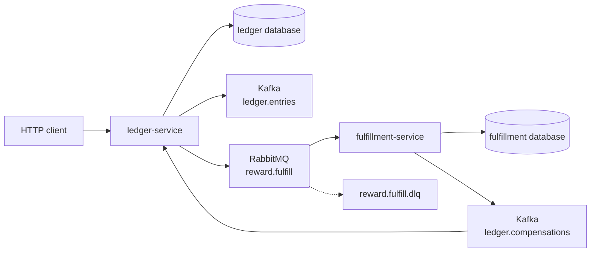
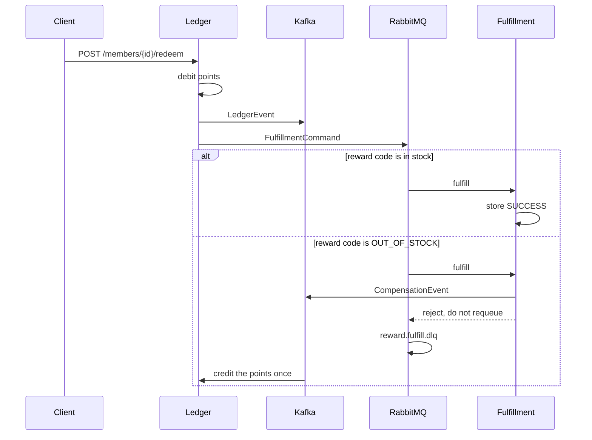

# Loyalty Ledger

A member earns points, spends them on a reward, and gets them back when the reward cannot be fulfilled.

The ledger debits the balance in the request that accepts the redeem. Kafka keeps the points log. RabbitMQ carries the fulfillment task. `OUT_OF_STOCK` is the reward code the fulfillment service treats as a failed reservation: it publishes a compensation event, then rejects the task onto `reward.fulfill.dlq`. The ledger credits those points once, keyed by the command id, so a repeated compensation does not pay twice.





## Why two brokers

Kafka is the log. Earn, redeem, and compensation are facts with a balance after each one. RabbitMQ is the work queue. Fulfillment either finishes or dead-letters. The compensation hop is how a failed task repairs the log without the fulfillment service writing the member balance itself.

The debit is committed with the redeem request. There is no outbox. A crash after the debit and before the broker accepts the command leaves a balance that no longer matches the log. The smoke script covers the path that does complete: debit, fulfill, compensate, dead letter.

## Run

JDK 17, Maven 3.9, and Docker.

```bash
mvn -q -DskipTests package
docker compose up --build -d
./scripts/smoke.sh
```

| Process | URL |
| --- | --- |
| ledger-service | http://localhost:8091 |
| fulfillment-service | http://localhost:8092 |
| RabbitMQ management | http://localhost:15674 |
| Postgres | localhost:5434 |
| Kafka (host listener) | localhost:9095 |

```bash
docker compose down
```

## Calls

```bash
curl -s -X POST localhost:8091/members \
  -H 'content-type: application/json' \
  -d '{"name":"Ana"}'

curl -s -X POST localhost:8091/members/$MEMBER/earn \
  -H 'content-type: application/json' \
  -d '{"points":100}'

curl -s -X POST localhost:8091/members/$MEMBER/redeem \
  -H 'content-type: application/json' \
  -d '{"points":40,"rewardCode":"COFFEE"}'

curl -s localhost:8092/fulfillments/$COMMAND
curl -s localhost:8091/members/$MEMBER
```

A redeem that would pass the balance answers `409`. A reward code of `OUT_OF_STOCK` answers with the debited balance, then the compensation brings the points back. That command has no fulfillment row. It is on `reward.fulfill.dlq`.

## Where the same split goes on Azure

This repository runs on Compose. Nothing in it calls a cloud account.

| Compose | Azure |
| --- | --- |
| Postgres 16 | Azure Database for PostgreSQL |
| Kafka 3.8 | Event Hubs |
| RabbitMQ 3.13 | Service Bus queue, with its dead-letter sub-queue |
| the two services | Container Apps or AKS |

## Local credentials

The Compose network is open. Do not publish these ports.

| | |
| --- | --- |
| Postgres | `platform` / `platform` |
| RabbitMQ | `platform` / `platform`, vhost `/` |
| HTTP | no authentication |

## Tests

`mvn test` checks the debit and credit rules with no Docker. `./scripts/smoke.sh` earns 100, redeems 40 for `COFFEE`, waits for `SUCCESS`, redeems 10 for `OUT_OF_STOCK`, waits until the balance is 60 again, and checks that the failed command is dead-lettered.

## Same shape, different domain

- [Live Lobby](https://github.com/joshbarros/java-live-lobby) projects session registrations from Kafka and confirms them on RabbitMQ.
- [Claims Desk](https://github.com/joshbarros/java-claims-desk) decides a claim from the log and checks its document on a work queue.
